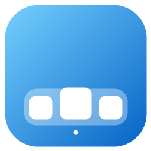
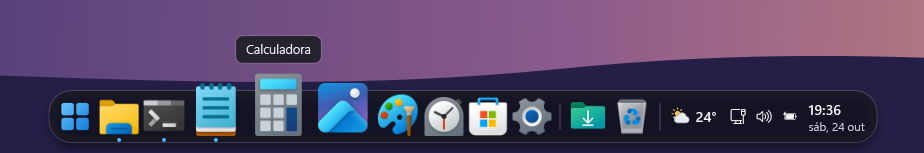
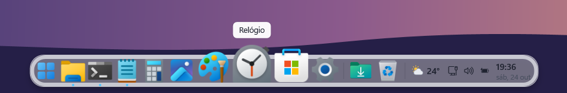
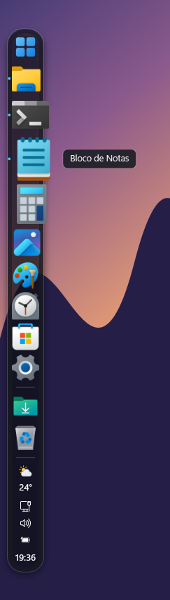
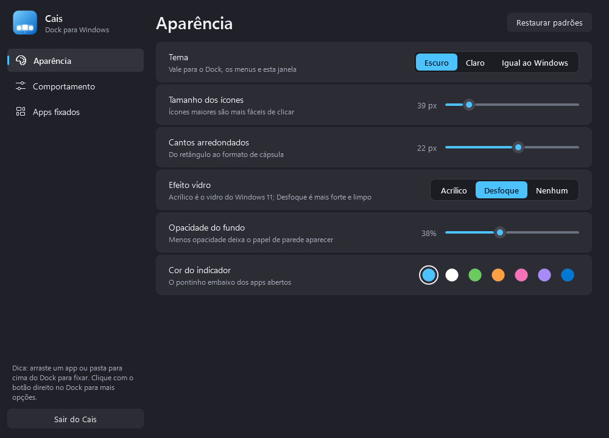
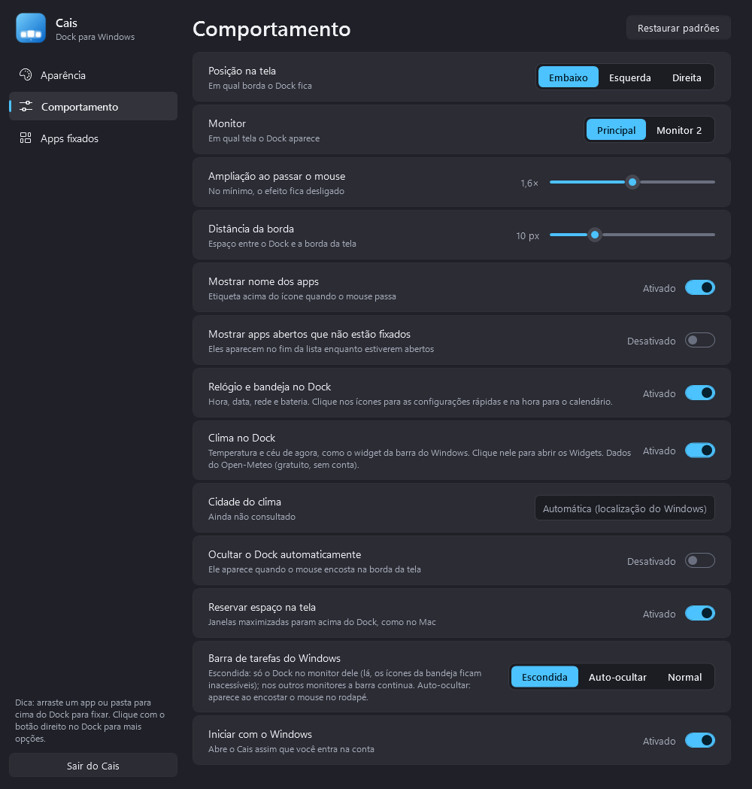
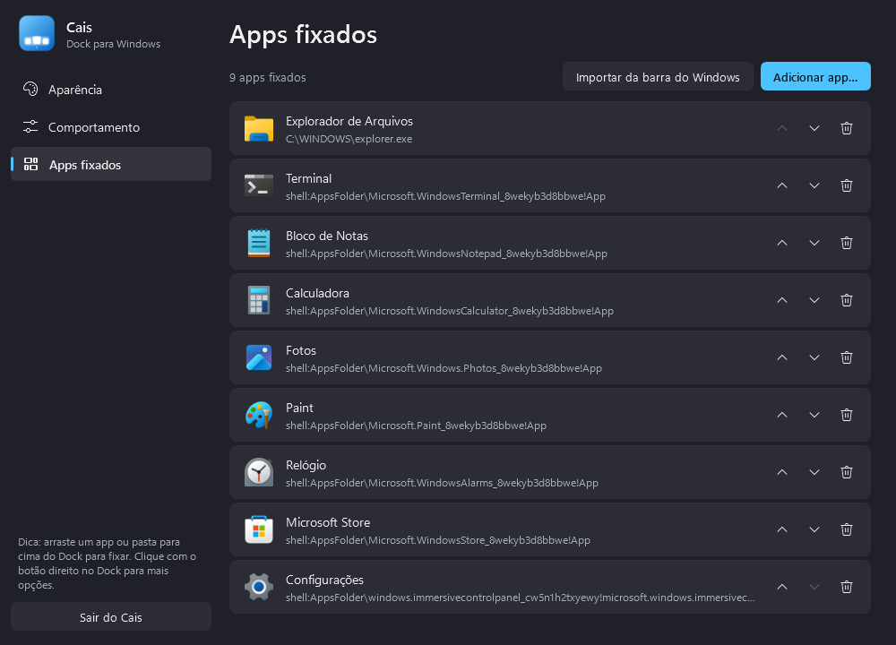
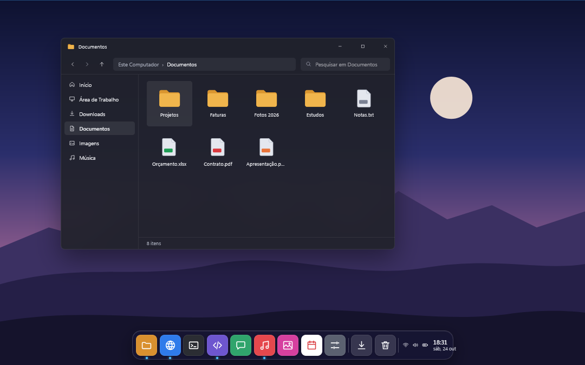
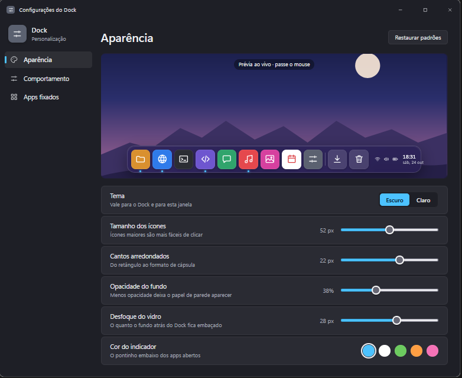

<p align="center">
  
</p>

<h1 align="center">Cais</h1>

<p align="center">
  <b>Um dock elegante para Windows, inspirado no do Mac.</b><br>
  Leve, nativo e sem dependências: um único <code>.exe</code> que roda no .NET Framework que já vem no Windows.
</p>

<p align="center">
  <a href="https://github.com/londarks/cais/releases/latest"></a>
  <a href="https://github.com/londarks/cais/actions/workflows/build.yml"></a>
  
  <a href="LICENSE"></a>
</p>

<p align="center">
  
</p>

> **Cais** (substantivo): o lugar do porto onde os barcos atracam. Um dock, em bom português.

## ✨ Recursos

- **Ampliação ao passar o mouse**, com a curva suave do Mac e o nome do app em cima do ícone
- **Vidro de verdade**: acrílico ou desfoque do próprio Windows atrás do Dock, com cantos arredondados
- **Fluido em monitores rápidos**: anima a 144 fps num monitor de 144 Hz e não gasta nada parado
- **Pontinho nos apps abertos**; apps abertos que não estão fixados aparecem no fim da lista
- **Clique inteligente**: abre o app; se já está aberto, traz para a frente; se já está na frente, minimiza; com várias janelas, alterna entre elas
- **Clima, relógio, rede e bateria** no próprio Dock, como na barra do Windows (clique no clima para os Widgets, nos ícones para as configurações rápidas e na hora para o calendário)
- **Apps da Microsoft Store**: fixe Calculadora, Terminal, Fotos etc. pelo seletor de apps instalados
- **Arraste e solte** qualquer app, atalho ou pasta em cima do Dock para fixar
- **Embaixo, à esquerda ou à direita**, em qualquer monitor; encolhe sozinho quando há apps demais
- **Reserva de espaço**: janelas maximizadas param acima do Dock, como no Mac
- **Some em jogos e vídeos em tela cheia** e volta quando você sai deles ou aperta a tecla Windows, sem piscar no Alt+Tab
- **Barra de tarefas do Windows** escondida, em auto-ocultar ou normal; nos outros monitores ela continua
- **Temas escuro, claro ou igual ao Windows**; tudo muda na hora, sem reiniciar

## 📸 Imagens

<table>
  <tr>
    <td width="72%"></td>
    <td rowspan="2" align="center"></td>
  </tr>
  <tr>
    <td></td>
  </tr>
</table>

<p align="center">
  
  
</p>

### Do conceito ao app

Antes da primeira linha de código, o Cais foi desenhado como um protótipo interativo. Estas são as telas daquele conceito; o app final seguiu essa direção, com os ícones reais dos seus programas.

<p align="center">
  
  
</p>

## 🚀 Instalação

### Baixar pronto

1. Baixe o `Cais.zip` na [página de versões](https://github.com/londarks/cais/releases/latest).
2. Extraia numa pasta fixa (por exemplo, `%LOCALAPPDATA%\Programs\Cais`) e abra o `Cais.exe`.

O executável não é assinado, então o Windows pode mostrar o aviso do SmartScreen na primeira vez: clique em **Mais informações › Executar assim mesmo**.

### Compilar

Requisitos: Windows 10 ou 11 e o [.NET SDK](https://dotnet.microsoft.com/download) 6 ou mais novo (só para compilar).

```powershell
git clone https://github.com/londarks/cais.git
cd cais
powershell -ExecutionPolicy Bypass -File .\instalar.ps1
```

O script compila, copia para `%LOCALAPPDATA%\Programs\Cais`, cria o atalho no menu Iniciar e abre o Dock. Na primeira vez, o Cais importa os apps que estavam fixados na sua barra de tarefas.

Para remover: `powershell -ExecutionPolicy Bypass -File .\desinstalar.ps1` (use `-ApagarConfig` para apagar também as configurações).

## 🖱️ Como usar

| Ação | O que acontece |
|---|---|
| Clique | Abre o app, traz para a frente ou minimiza |
| Clique com o botão do meio, ou Shift + clique | Abre uma nova janela |
| Botão direito em um app | Janelas abertas, nova janela, fixar/remover, fechar |
| Botão direito no Dock | Ocultar automaticamente, mostrar a barra do Windows, configurações, sair |
| Arrastar um arquivo para o Dock | Fixa o app, atalho ou pasta |
| Abrir o Cais de novo (menu Iniciar) | Abre as configurações |

As configurações ficam em `%APPDATA%\Cais\config.json`, e os erros (se houver) em `%APPDATA%\Cais\erros.log`.

## 🔒 Privacidade

O Cais não tem conta, anúncios nem telemetria. A única coisa que ele busca na internet é o **clima**, no [Open-Meteo](https://open-meteo.com) (serviço público, gratuito e sem cadastro), usando a localização do Windows ou a cidade que você digitar. Dá para desligar o clima nas configurações.

## ⚙️ Como funciona

- **WPF no .NET Framework 4.8**, que já vem instalado no Windows: nada de runtime extra.
- O Dock usa duas janelas: uma transparente para os ícones, que não rouba o foco e deixa o clique passar fora do Dock, e outra atrás só para o vidro (`SetWindowCompositionAttribute`, a mesma API da barra de tarefas), arredondada pelo próprio Windows 11 e atualizada numa thread separada.
- Os ícones se movem só por transformações (sem recalcular layout), e a sombra é uma imagem pré-renderizada. Com isso, a animação foi de ~75 para ~140 quadros por segundo.
- Os ícones vêm do shell do Windows em 256 px (`IShellItemImageFactory`), inclusive os de apps da Store.
- Os apps abertos são descobertos com a mesma regra do Alt+Tab e atualizados por eventos do sistema (`SetWinEventHook`).
- A reserva de espaço usa a API de barras de aplicativo (`SHAppBarMessage`), a mesma da barra de tarefas.

Ferramentas para quem for mexer no código:

- `Cais.exe --snapshot docs --demo` gera as imagens deste README sem abrir nada na tela.
- `Cais.exe --bench` simula o mouse passando pelo Dock por 6 segundos e grava quadros por segundo e uso de CPU em `%APPDATA%\Cais\perf.log`.

## 🧭 Limitações conhecidas

- Com a barra do Windows **escondida**, os ícones da bandeja ficam inacessíveis no monitor do Dock (nos outros monitores a barra continua). Se você usa muito a bandeja, escolha **Auto-ocultar**.
- A intensidade do desfoque é definida pelo Windows; dá para escolher entre acrílico, desfoque ou nenhum.
- Em PCs sem localização (a maioria dos desktops), digite sua cidade em **Configurações › Comportamento › Cidade do clima**.

## 📄 Licença

[MIT](LICENSE)
